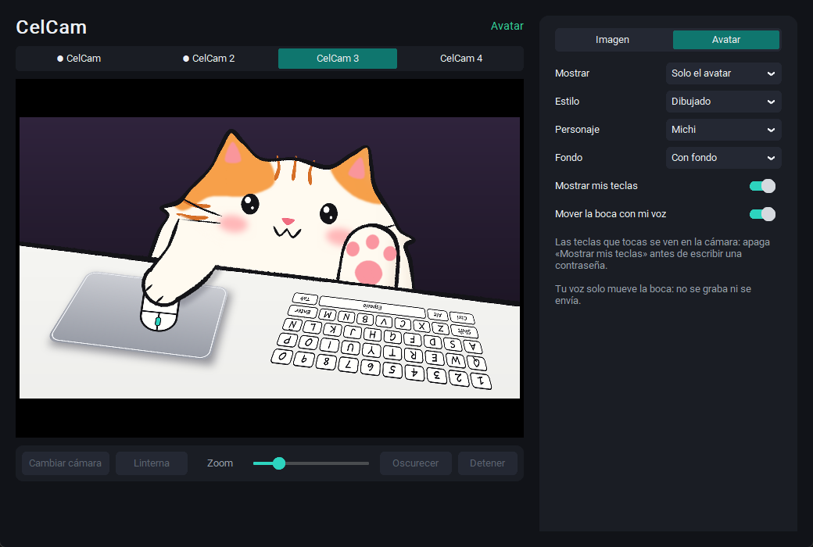

# CelCam

Use your Android phone as a webcam on Windows. Free, open source, no ads, no accounts.

[Español más abajo](#español)



## What it does

CelCam has two parts: an Android app and a Windows program. The Windows program creates virtual cameras called
"CelCam", "CelCam 2", "CelCam 3" and "CelCam 4", which video apps can pick like any webcam. The phone sends its video
directly to the PC over your WiFi or a USB cable. Nothing goes through a server.

- Up to 1080p and 30, 60 or 120 frames per second, if the phone's camera supports it (the app uses the fastest it can)
- Connect by scanning a QR code, or with a USB cable
- Up to four phones at once, each one always on its own camera
- Front and rear cameras, zoom, flashlight, rotate and mirror, from the phone or from the PC
- See the phone's battery on the PC, with a warning when it runs low
- Avatars that work without a phone: they follow your mouse, light up the keys you press and move their mouth when you
  speak. Eight characters in two styles, with a normal, transparent (OBS) or green background, alone or small over your
  video
- The stream keeps running with the phone's screen off
- Closing the window keeps CelCam running, with an icon next to the clock
- Change quality or frame rate while an app is using the camera, without choosing it again
- Video is encrypted between the phone and the PC, and the PC only accepts phones that scanned its QR code

Tested with OBS Studio, Discord and Microsoft Edge. Other apps that use DirectShow cameras should see it too.

**Limits:** video only (use your PC or headset microphone). Windows 10 or 11, 64-bit. Android 7 or newer. No iPhone
version. The Windows Camera app may not show the camera, because it does not list this type of virtual camera.

**Status:** early version, still being tested on real phones and PCs. Each build runs the real installer on a clean
Windows machine and checks the camera with a simulated phone.

## Install

1. Download `CelCam-Instalador-x.y.z.exe` from [Releases](../../releases) and run it on your PC.
2. Open CelCam and click "¿No tienes la app? Instálala" to get the app on your phone. You can also download
   `CelCam.apk` from Releases.
3. Open the app, tap "Escanear código" and scan the code on your PC.
4. In your video app, choose the camera "CelCam".

The interface is in Spanish.

## Build from source

Needs Visual Studio 2022 Build Tools (C++), Python 3.12, JDK 17, Gradle 8.9, the Android SDK and Inno Setup.

```
python -m venv pc\.venv
pc\.venv\Scripts\python -m pip install -r pc\requirements-dev.txt
powershell -NoProfile -ExecutionPolicy Bypass -File scripts\construir.ps1
```

Tests: `pc\.venv\Scripts\python -m pytest pc\tests`. Published builds are made only by
[GitHub Actions](.github/workflows/build.yml), from the code in this repository.

## Code signing policy

Release builds are produced only by the GitHub Actions workflow in this repository, from this public source code.
Each signing request needs manual approval from a member of the team below.

Signing through the SignPath Foundation is being requested. **Current releases are not signed**, so Windows shows a
warning, and Windows 11 PCs with Smart App Control turned on block them.

- Committers and reviewers: [@celcam-app](https://github.com/celcam-app)
- Approvers: [@celcam-app](https://github.com/celcam-app)

## Privacy policy

This program will not transfer any information to other networked systems unless specifically requested by the user or
the person installing or operating it.

In practice: video goes only from your phone to the PC you paired it with. There are no analytics. If you choose to
connect by USB cable, CelCam asks first and then downloads Android's `adb` tool from Google, under
[Google's terms](https://developer.android.com/studio/terms).

Only while an avatar is on, CelCam reads which keys are pressed, where the mouse is and how loud your microphone is, to
animate the character. It does not save any of this or send it anywhere, and no audio is recorded. The pressed keys can
be seen in the camera image, so turn off "Mostrar mis teclas" before typing a password. You can also turn off the
voice option.

## Changes the installer makes

The installer registers the virtual camera and adds a Windows Firewall rule so the phone can connect to CelCam. It
tells you this before installing, and uninstalling removes both.

## License

[GPL-3.0-or-later](LICENSE). Third-party components are listed in [TERCEROS.txt](TERCEROS.txt). The virtual camera is
based on [Softcam](https://github.com/tshino/softcam) (MIT); the changes are described in
[vcam/softcam/CAMBIOS_CELCAM.md](vcam/softcam/CAMBIOS_CELCAM.md).

## Español

CelCam convierte tu celular Android en una webcam para Windows. Es gratis y de código abierto, sin anuncios y sin
cuentas. El video va directo del celular a tu PC, por WiFi o por cable USB, sin pasar por ningún servidor.

**Cómo instalarla**

1. Descarga `CelCam-Instalador-x.y.z.exe` desde [Releases](../../releases) y ábrelo en tu PC.
2. Abre CelCam y toca «¿No tienes la app? Instálala» para pasarla a tu celular.
3. En el celular, abre la app, toca «Escanear código» y apunta al código de la PC.
4. En tu app de video, elige la cámara «CelCam».

**Con qué funciona:** se probó con OBS Studio, Discord y Microsoft Edge. Las demás apps que usan cámaras DirectShow
también deberían verla. La app Cámara de Windows y las de la Tienda todavía no la ven.

**Varios celulares:** hasta cuatro a la vez, cada uno en su cámara (CelCam, CelCam 2, 3 y 4). Desde la PC puedes
cambiar de cámara, usar la linterna y el zoom, oscurecer la pantalla, detener y ver la batería de cada celular.

**Avatares:** funcionan sin celular. Siguen tu mouse, iluminan las teclas que tocas y mueven la boca cuando hablas. Hay
ocho personajes en dos estilos, con fondo normal, transparente (para OBS) o verde, solos o chicos sobre tu video.

**Privacidad de los avatares:** solo con un avatar prendido, CelCam lee qué teclas tocas, dónde está el mouse y el
volumen del micrófono. No guarda ni envía nada, y no graba audio. Las teclas se ven en la imagen de la cámara: apaga
«Mostrar mis teclas» antes de escribir una contraseña.

**Para cerrarla:** con la X, CelCam sigue funcionando con un ícono junto al reloj. Para cerrarla del todo, abre ese
ícono y elige «Salir».

**Límites:** solo video (usa el micrófono de la PC o de tus auriculares). Windows 10 u 11 de 64 bits y Android 7 o
posterior. No hay versión para iPhone. Es una versión nueva y todavía se está probando.

**Aviso:** las versiones actuales no tienen firma digital, así que Windows muestra una advertencia, y las PC con
Windows 11 que tienen activado Control inteligente de aplicaciones las bloquean.
